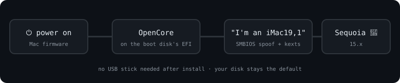
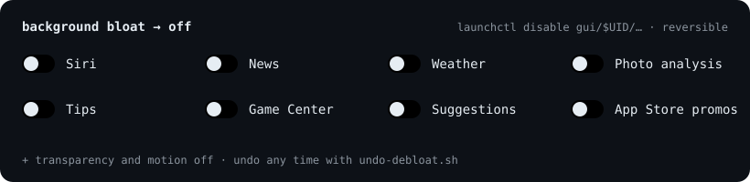

# 2017 iMac (iMac18,x) → macOS Sequoia with OpenCore Legacy Patcher

<p align="center"></p>

Apple stops 2017 iMacs at **macOS Ventura 13**. This repo takes one to **macOS Sequoia 15** with
[OpenCore Legacy Patcher](https://github.com/dortania/OpenCore-Legacy-Patcher) (OCLP). It works whether the Mac boots from the internal drive or an external SSD.

## Does this apply to you?

| Mac | Status |
|---|---|
| iMac18,2 (21.5" 4K, 2017) | ✅ Tested, booting from an external USB‑C SSD |
| iMac18,2 booting from its internal drive | 🟡 Same steps. Untested |
| iMac18,1 / iMac18,3 (other 2017 iMacs) | 🟡 Same model check and fix expected. Untested |
| Any other Intel Mac | ❓ Check [OCLP's supported models](https://dortania.github.io/OpenCore-Legacy-Patcher/MODELS.html) first |
| Apple Silicon Mac | ❌ Not needed. Use Software Update |

**You'll need:** OCLP 2.5.1 or newer, a USB stick of 32 GB or more (it gets erased), a **wired** keyboard, an admin password, about 2 hours, and a backup.

## How it boots

<p align="center"></p>

## Step matrix

| # | Step | How | Command / clicks | sudo | Restart | Check it worked |
|---|---|---|---|:-:|:-:|---|
| 0 | Name your disks | Terminal | `bash scripts/diag-efi.sh` with no settings lists every disk's Media Name | | | You know the stick's and the boot disk's names |
| 1 | Install OCLP | Browser | [OCLP releases](https://github.com/dortania/OpenCore-Legacy-Patcher/releases), run the `.pkg` | ✔ | | `OpenCore-Patcher.app` is in Applications |
| 2 | OpenCore onto the boot disk | OCLP | *Build and Install OpenCore* → *Install to disk* → boot disk → EFI | ✔ | ✔ | `nvram 4D1FDA02-38C7-4A6A-9CC6-4BCCA8B30102:opencore-version` prints a version |
| 3 | Make the installer stick | OCLP | *Create macOS Installer* → *Download* → Sequoia → *Flash Installer* → stick | ✔ | | A volume named "Install macOS Sequoia" appears |
| 4 | OpenCore onto the stick | OCLP | Say **yes** when asked → stick → **EFI** → *Install* | ✔ | | `diag-efi.sh` shows a `config.plist` on the stick |
| 5 | Copy it to the boot disk | Script | `bash scripts/sync-oc-to-disk.sh` | ✔ | | Prints `RESULT: OK` |
| 6 | Spoof a supported model | Script | `bash scripts/spoof-smbios.sh` | ✔ | ✔ | `ioreg -lp IODeviceTree -d2 \| grep board-id` shows `Mac-AA95B1DDAB278B95` (iMac19,1). `hw.model` may still show the real model, and that's fine |
| 7 | Install Sequoia | Installer | `open "/Applications/Install macOS Sequoia.app"` → pick the boot disk | ✔ | ✔✔✔ | `sw_vers -productVersion` prints 15.x |
| 8 | Optional speed-up | Script | `bash scripts/debloat.sh` | | | Prints `off: …` lines |

## Commands, in order

```bash
git clone https://github.com/butterpurse-dot/imac-2017-macos-sequoia-opencore.git
cd imac-2017-macos-sequoia-opencore

sysctl -n hw.model                        # expect iMac18,x
bash scripts/diag-efi.sh                  # lists your disks' Media Names
export STICK_NAME="<stick media name>" BOOT_DISK_NAME="<boot disk media name>"

# steps 1–4 happen in the OCLP app (see the matrix), then:
bash scripts/diag-efi.sh                  # stick must show EFI/OC/config.plist
bash scripts/sync-oc-to-disk.sh           # → RESULT: OK
bash scripts/spoof-smbios.sh              # → RESULT: OK
sudo shutdown -r now                      # OpenCore starts the boot disk by itself

open "/Applications/Install macOS Sequoia.app"   # pick the boot disk · ☕ about an hour
sw_vers -productVersion                   # 15.x 🎉
bash scripts/debloat.sh                   # optional
```

Backups go to `/Users/Shared/OC-backup-<date>/`. To undo the spoof, copy `config.before-spoof.plist` back to `EFI/OC/config.plist` on the boot disk's EFI partition.

<p align="center"></p>

## What to expect afterwards

| Area | Expected | Check |
|---|:-:|---|
| Graphics (Polaris + Intel) | ✅ Metal, accelerated | `ioreg -rc IOAccelerator \| grep IOClass` |
| Built-in Retina display | ✅ Full resolution | `system_profiler SPDisplaysDataType` |
| Wi‑Fi (Broadcom) | ✅ Through OCLP's kexts | `kmutil showloaded \| grep -iE "80211FamilyLegacy\|airportbrcm"` |
| Bluetooth, audio, camera, Ethernet | ✅ | `system_profiler SPBluetoothDataType SPAudioDataType SPCameraDataType` |
| Kernel panics | ✅ None | `ls /Library/Logs/DiagnosticReports \| grep -i panic` |
| Sequoia 15.x updates | ✅ OCLP re-applies its patches after the restart | `sw_vers` |
| `shutdown_stall` reports | ✅ Harmless. macOS logs one whenever shutdown takes over 2 s | |
| SIP | ⚠️ Off. OCLP requires it | `csrutil status` |

## Common problems

| Symptom | Cause | Fix |
|---|---|---|
| No boot picker when holding ⌥ | Wireless keyboard (2.4 GHz dongle or Bluetooth) | Use a wired keyboard |
| `bless … 0xe00002e2` | Can't bless while booted through OpenCore | Not needed. OCLP already set the boot disk's OpenCore as default |
| Startup error on every EFI entry | The stick's EFI is **empty**. The flash ended before OpenCore was installed | Redo step 4. Confirm with `diag-efi.sh` |
| 🚫 + `support.apple.com/mac/startup` | The boot disk's OpenCore (built for the old macOS) started the installer | `sync-oc-to-disk.sh` |
| "not compatible" / "cannot be installed on this computer" | Sequoia only accepts iMac19,1 and newer | `spoof-smbios.sh` |

## Make it fast

<p align="center"></p>

- `scripts/debloat.sh` stops 16 stock background services (Siri, News, Weather, photo analysis, Tips, Game Center, Suggestions, App Store promos) and turns off transparency and motion. `scripts/undo-debloat.sh` reverts it.
- Look for helpers left behind by apps you've uninstalled: `ls /Library/LaunchDaemons /Library/LaunchAgents ~/Library/LaunchAgents`.
- iOS Simulator and Xcode builds are heavy. On an 8 GB Mac, shut simulators down when you're done: `xcrun simctl shutdown all`.
- The real upgrade is **RAM**. 21.5" 2017 iMacs have SO‑DIMM slots behind the display, up to 32 GB.

## Keep it working

- Sequoia 15.x security updates through System Settings are fine. After the restart OCLP offers to re‑apply its patches. Accept and restart. Wi‑Fi may be missing until then.
- Major upgrades never install automatically. Wait until OCLP supports the next macOS.
- Keep OCLP updated. It tells you when there's a new version.
- If the Mac won't boot, hold ⌥ and pick your boot disk.

## Scripts

| Script | Does | sudo |
|---|---|---|
| [`diag-efi.sh`](scripts/diag-efi.sh) | Lists disks, and checks OpenCore on the stick and the boot disk (read-only) | ✔ |
| [`sync-oc-to-disk.sh`](scripts/sync-oc-to-disk.sh) | Copies the stick's OpenCore to the boot disk, with a backup | ✔ |
| [`spoof-smbios.sh`](scripts/spoof-smbios.sh) | Sets the model to iMac19,1 (or `MODEL=…`), with a backup | ✔ |
| [`debloat.sh`](scripts/debloat.sh) / [`undo-debloat.sh`](scripts/undo-debloat.sh) | Background services off / back on | ✘ |

Every disk script needs `STICK_NAME` and/or `BOOT_DISK_NAME` set to the disk's **Media Name**, and refuses to run without them.

> ⚠️ Unsupported by Apple. Back up first. Use at your own risk.

MIT licensed.
